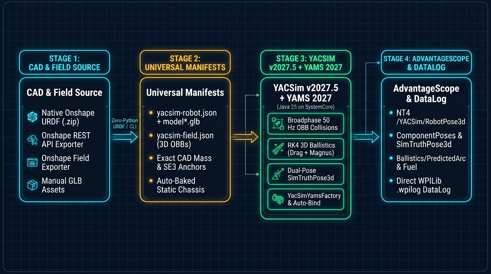

# YACSim — Yet Another CAD Simulator

[](https://github.com/HolyArtist31656/YACS/actions/workflows/ci.yml)
[](https://docs.wpilib.org/en/2027/)
[](https://adoptium.net/)
[](LICENSE.txt)



**YACSim** (`v2027.4.0-alpha1`) is a lightweight, zero-extra-dependency 3D CAD simulation vendordep for **WPILib 2027 (`2027_alpha7`, Java 25, Commands v3)** designed to pair cleanly with [YAMS (Yet Another Mechanism Suite)](https://yams.yassrobotics.com/) and [AdvantageScope](https://docs.advantagescope.org/) on the 2 GB RAM SystemCore.

## Online Installation (WPILib 2027 VS Code)

Install via **WPILib: Manage Vendor Libraries → Install new libraries (online)**:

```text
https://holyartist31656.github.io/YACS/vendordeps/yacsim_commands3.json
```

- **Maven Repository**: `https://holyartist31656.github.io/YACS/maven/releases/`
- **Hosted Java API Javadoc**: `https://holyartist31656.github.io/YACS/javadoc/`
- **Required Dependencies**: `CommandsV3.json` and `yams_commands3.json`

## Features

- **Native Onshape URDF `.zip` Import & Code-Side CAD Repair**: Drop Onshape's built-in `Assembly -> Export -> Format: URDF (GLB)` `.zip` directly into `deploy/` and load via `CadRobotConfig.fromUrdfOrZip(Path, CadUrdfOptions)` with Zip-Slip protection, pure-Java `GlbMerger` deduplication, unified Z-grounding, code-side fastener filtering (`CadUrdfOptions.recommended()`), automatic moving-subtree baking (`bakeUnboundLinksIntoChassis(true)`), 1-line re-parenting (`attachLinksToJoint(...)`), selective `NOSIMPLIFY` mesh tagging, and safe `*Or(...)` fallback getters—strictly additive alongside Manual Java, AdvantageScope Dir, `yacsim-robot.json`, and the Python Onshape Exporter.
- **Seamless Real-Robot Pass-Through Factory (`YacSimYamsFactory`)**: Pass a YAMS 2027 mechanism config and `SmartMotorController` to `createArm`, `createElevator`, `createPivot`, or `createFlyWheel` and get back the plain YAMS mechanism. On real hardware (`RobotBase.isReal()`), YACSim short-circuits with zero CAD disk I/O or OBB overhead; in simulation, it auto-binds, chains nested URDF joints, and steps `simIterate()` / `updateTelemetry()` automatically.
- **Startup Diagnostics & Forgiving Auto-Binding (`YacSimDiagnostic` + `YamsCommands3Bridge.autoBind`)**: Prints every CAD joint's bound/unbound status, spatial `(X, Y, Z)` coordinates, and fuzzy token-similarity `.withJointAlias(...)` suggestions so default Onshape mate names (`revolute_1`) never break startup.
- **Direct YAMS & Commands v3 Adapters + Animated Swerve Overlays**: Wire YAMS `Arm`, `Elevator`, `Pivot`, `FlyWheel`, rollers/intake bars, and `SwerveDrive` mechanisms directly with `YamsCommands3Bridge` (including automatic nested URDF parent-child chaining via `chainFromManifest(...)` and 4-corner animated swerve steer forks & spinning wheels via `attachSwerveModules(...)`).
- **Native CAD Mesh Parsing (with glTF Node-Graph Transforms & In-Memory Cache)**: Parses `.glb` / `.gltf` (glTF 2.0 with recursive scene-graph `matrix` / `T*R*S` traversal), `.obj`, and ASCII/binary `.stl` directly in Java without loading GPU buffers or pulling third-party JSON/mesh JARs.
- **Zero-Allocation Broadphase & 15-Axis SAT Collisions**: Pre-filters separated component pairs with bounding-sphere broadphase rejection before running allocation-free 15-axis SAT and extension-envelope checks, with `ignoreRestingOverlaps()`, `ignoreCollisionPair(a, b)`, and Commands v3 `CadCollisionTriggers`.
- **AdvantageScope 3D Pipeline**: Publishes `RobotPose`, `RobotPose3d`, `ComponentPoses`, `CollisionActive`, `CollisionDetails`, and `/YACSim/Rollers/<name>/` over NT4, exports ready-to-load `Robot_<Name>` AdvantageScope asset bundles with ordered multi-axis rotations and camera frustums, and imports existing `Robot_<Name>/config.json` directories in one line (`fromAdvantageScopeDir`).
- **SystemCore 2 GB Performance**: Benchmarked against FRC Team 6328 Mechanical Advantage's publicly released MIT-licensed 2026 *Darwin* CAD assets (2.1M+ triangles across 5 `.glb` meshes) under a strict `-Xmx256m` robot JVM cap with `~0.64 ms` `robotPeriodic()` telemetry overhead and zero steady-state loop overruns.

## Quickstart (Pass-Through Factory)

```java
// Zero-overhead pass-through on real hardware (RobotBase.isReal());
// full 3D URDF CAD binding + OBB physics in simulation (RobotBase.isSimulation()).
YacSimYamsFactory yacsim =
    YacSimYamsFactory.fromUrdfOrZip(
        Filesystem.getDeployDirectory().toPath().resolve("yacsim/my_robot_urdf.zip"),
        CadUrdfOptions.recommended()
            .withJointAlias("revolute_1", "Turret")
            .withJointAlias("revolute_8", "Hood")
            .keepOnlyJoints(List.of("Turret", "Hood"))
            .bakeUnboundLinksIntoChassis(true));

Pivot turret = yacsim.createPivot("Turret", pivotConfig, turretMotor);
Arm hood = yacsim.createArm("Hood", armConfig, hoodMotor); // auto-chains onto rotating Turret!
yacsim.startSimulator();
```

Call `yacsim.updateTelemetry()` from `robotPeriodic()` and `yacsim.simIterate()` from `simulationPeriodic()` (or a `Notifier`). For full manual Java control without `YacSimYamsFactory`, see [Getting Started](docs/GETTING_STARTED.md) and [Native Onshape URDF Guide](docs/ONSHAPE_URDF_GUIDE.md).

## Documentation

| Guide | Description |
| --- | --- |
| [Getting Started](docs/GETTING_STARTED.md) · [Implementation Walkthrough](docs/IMPLEMENTATION_WALKTHROUGH.md) | Installation, prerequisites, first simulation, and AdvantageScope setup |
| [Guides](docs/GUIDES.md) · [Native Onshape URDF Guide](docs/ONSHAPE_URDF_GUIDE.md) · [CAD Manifest & URDF Guide](docs/CAD_MANIFEST_GUIDE.md) · [Onshape Exporter Guide](docs/ONSHAPE_EXPORTER_GUIDE.md) · [CAD-to-Code Naming Conventions](docs/CAD_CODE_NAMING_CONVENTIONS.md) | CAD prep, code-side CAD repair, multi-axis rotations, YAMS adapters, auto-calibrated collisions, and public *Darwin* CAD walkthrough |
| [Java API Reference](docs/API_REFERENCE.md) | Class-by-class reference across all 8 packages (+ [Hosted Javadoc](https://holyartist31656.github.io/YACS/javadoc/)) |
| [Unit Tests](docs/UNIT_TESTS.md) | Reference for all 8 JUnit 5 test classes (**61 JUnit 5 tests**) + **9 Python exporter tests** |
| [Architecture & Performance](docs/ARCHITECTURE.md) | SystemCore 2 GB memory model, lock-free `SimSnapshot` threading, and public *Darwin* CAD benchmarks |
| [Examples](examples/README.md) | Runnable WPILib 2027 Commands v3 examples (`arm_and_elevator_2027`, `darwin_6328_2027`, `darwin_6328_manifest_2027`, `gears_2181_2027`) |
| [Changelog](docs/CHANGELOG.md) | Version history and release notes |

## Building Locally

```powershell
cd vendordep
.\gradlew build test javadoc "-Dorg.gradle.java.home=C:\Users\Public\wpilib\2027_alpha7\jdk"
```

## Open-Source Inspiration & Attribution

YACSim is an **independent community project** inspired by the public open-source work of the FRC software ecosystem:

- **[WPILib (2027 Alpha / Commands v3)](https://github.com/wpilibsuite/allwpilib):** Core robot framework, WPILib Units, SE(3) geometry (`Pose3d` / `Transform3d`), and NetworkTables v4 struct serialization.
- **[AdvantageScope](https://docs.advantagescope.org/) (FRC Team 6328 Mechanical Advantage):** 3D Field custom robot asset format (`config.json`, `model*.glb`, `NOSIMPLIFY` mesh tags) and NT4 `Pose3d[]` visualization conventions. The `darwin_6328_*` examples independently reference Team 6328's publicly released MIT-licensed 2026 *Darwin* CAD assets ([RobotCode2026Public](https://github.com/Mechanical-Advantage/RobotCode2026Public)) as a high-poly benchmark.
- **[Yet Another Software Suite (YASS / YAMS / YAGSL)](https://www.yassrobotics.com/):** Mechanism simulation APIs (`Arm`, `Elevator`, `Pivot`, `FlyWheel`, `SwerveDrive`), split `core`/`commands3` packaging architecture, and LGPL-3.0 licensing model.

*Disclaimer: YACSim is developed independently and is not officially affiliated with, endorsed by, built by, or tested by FRC Team 6328 Mechanical Advantage, Yet Another Software Suite (YASS), WPILib, or any other third-party FRC team.*

## License

Licensed under **LGPL-3.0**.
