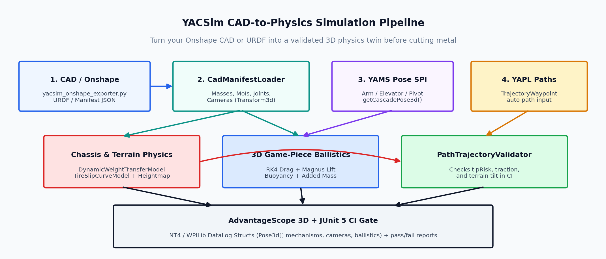
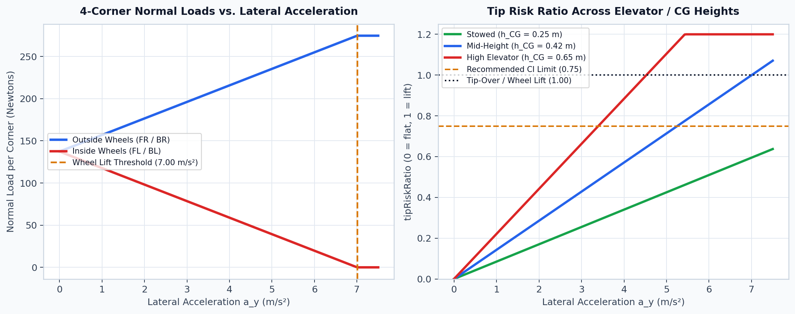

# YACS — Yet Another CAD Simulator

[](https://github.com/HolyArtist31656/YACS/actions/workflows/ci.yml)
[](https://github.com/wpilibsuite/allwpilib/releases)
[](https://openjdk.org/)
[](LICENSE.txt)

Turn your Onshape CAD assembly or URDF into a physics-validated **3D FRC 2027 digital twin** — with automated camera transform extraction, 4-corner dynamic CG weight transfer, Pacejka tire slip, field bump terrain, RK4 aerodynamic ballistics, and CI trajectory validation.

<p align="center">
  
</p>

## Documentation

* **Guides & Tutorials:** [YACS Documentation (`docs/documentation/`)](docs/documentation/README.md)
* **Why YACS?:** [Why YACS?](docs/documentation/why-yacs.md)
* **4-Step Tutorial:** [Your First CAD-to-Sim Robot](docs/documentation/tutorials/first-cad-sim/README.md)
* **How-To Guides:** [Onshape & Camera Extraction](docs/documentation/how-to/export-onshape-and-cameras.md) · [Bumps & Tire Slip](docs/documentation/how-to/simulate-bumps-and-tire-slip.md) · [Validate YAPL Paths in CI](docs/documentation/how-to/validate-yapl-trajectories-in-ci.md) · [3D RK4 Ballistics](docs/documentation/how-to/simulate-3d-ballistics-and-tune-drag.md)
* **API Reference:** [API Overview](docs/api-reference/README.md)
* **Changelog:** [Release Notes](docs/changelog/README.md)

## Key Features

* **Automated CAD & Camera Extraction:** `yacsim_onshape_exporter.py` and `CadManifestLoader` load link masses, moments of inertia, joints, and `cam_*` / `limelight*` / `photon*` camera `Transform3d` mounts directly from Onshape or URDF.
* **4-Corner Weight Transfer & 3-Wheel Lift:** `DynamicWeightTransferModel` computes exact corner normal loads and `tipRiskRatio` across changing elevator/arm CG heights.
* **Pacejka Tire Slip & Field Terrain:** `TireSlipCurveModel` models peak-to-kinetic grip drop-off; `TerrainBumpHeightmap` projects 2D poses onto cable protectors and ramps.
* **CI Autonomous Path Validation:** `PathTrajectoryValidator` checks YAPL/Choreo trajectories in JUnit 5 and fails CI before a tipping or skidding auto reaches competition carpet.
* **Calibrated 3D RK4 Ballistics:** Models quadratic air drag, Magnus backspin lift, buoyancy (3.3%), and added mass (1.7%) with a 2-observable calibration fitter.
* **YAMS 2027 Pose SPI Parity:** Connects cleanly to YAMS public pose getters (`getCascadePose3d`, `getContinuousPose3d`, `getUpperPose3d`, `DifferentialMechanism.getPose3d`).

## Installation (WPILib 2027 Vendordep)

Copy `vendordeps/yacsim_commands3.json` into your robot project's `vendordeps/` directory (or publish locally from `vendordep/` with `./gradlew publishToMavenLocal`). See [Install YACS](docs/documentation/tutorials/install-yacs.md) for full details.

## Quick Example

```java
DynamicWeightTransferModel weight = new DynamicWeightTransferModel(0.60, 0.60);
TireSlipCurveModel tires = new TireSlipCurveModel(TreadPreset.COLSON_GRIP.config());
TerrainBumpHeightmap terrain = new TerrainBumpHeightmap();
terrain.addCableProtector("CenterCable", 2.0, 0.0, 2.4, 8.21, 0.032);

PathTrajectoryValidator validator = new PathTrajectoryValidator(weight, tires, terrain);
ValidationReport report = validator.validate(
    sampledAutoWaypoints,
    56.0,
    new Translation3d(0.0, 0.0, 0.42),
    new ValidationLimits(0.75, 0.92, 12.0)
);
assertTrue(report.feasible(), report.summary());
```

## Visual Guides

<p align="center">
  
</p>

## License

YACS is licensed under the **GNU Lesser General Public License v3.0 (LGPL-3.0-or-later)**. See [LICENSE.txt](LICENSE.txt) for details.

## Contributing

Contributions, bug reports, and feature requests are welcome! See [CONTRIBUTING.md](CONTRIBUTING.md) to get started.
