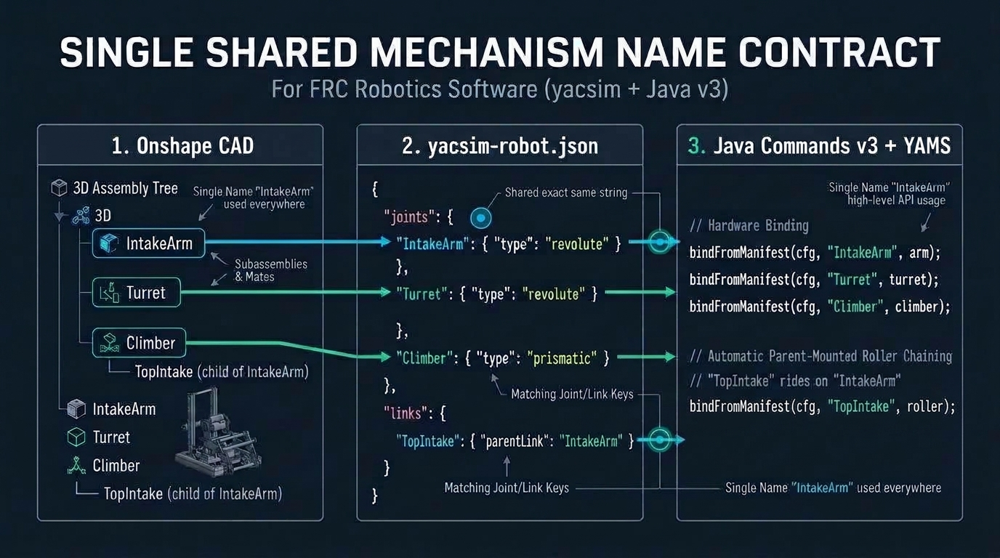

# CAD-to-Code Naming Conventions (Onshape <-> YACSim / YAMS)

When CAD and Programming agree on a single shared naming contract up front, `tools/onshape-exporter/yacsim_onshape_exporter.py` and YACSim's `CadRobotConfig.fromManifest(...)` connect your Onshape assembly directly to your Java mechanisms with **zero manual coordinate copying**.



---

## 1. The Single Shared Mechanism Name Rule

Pick one concise **`PascalCase`** name per actuated mechanism—no spaces, slashes, or special characters—and use that **exact name** across CAD, JSON, and Java:

| Onshape Subassembly | Onshape Mate Name (or `yacsim_` prefix) | `yacsim-robot.json` Joint & Link | Java Mechanism Class | YACSim Binding Call |
| :--- | :--- | :--- | :--- | :--- |
| `IntakeArm` | `IntakeArm` (or `yacsim_IntakeArm`) | `"IntakeArm"` | `IntakeArmMechanism` | `YamsCommands3Bridge.bindFromManifest(cfg, "IntakeArm", intakeArm.getArm())` |
| `Turret` | `Turret` (or `yacsim_Turret`) | `"Turret"` | `TurretMechanism` | `YamsCommands3Bridge.bindFromManifest(cfg, "Turret", turret.getPivot())` |
| `Climber` | `Climber` (or `yacsim_Climber`) | `"Climber"` | `ClimberMechanism` | `YamsCommands3Bridge.bindFromManifest(cfg, "Climber", climber.getElevator())` |
| *(roller shaft)* | `Shooter` (or `yacsim_Shooter`) | `"Shooter"` | `ShooterMechanism` | `YamsCommands3Bridge.bindFromManifest(cfg, "Shooter", shooter.getMotor())` |
| *(roller shaft)* | `Spindexer` (or `yacsim_Spindexer`) | `"Spindexer"` | `SpindexerMechanism` | `YamsCommands3Bridge.bindFromManifest(cfg, "Spindexer", spindexer.getMotor())` |
| *(roller shaft)* | `TopIntake` (or `yacsim_TopIntake`) | `"TopIntake"` | `TopIntakeMechanism` | `YamsCommands3Bridge.bindFromManifest(cfg, "TopIntake", topIntake.getMotor())` |
| *(roller shaft)* | `Input` (or `yacsim_Input`) | `"Input"` | `InputMechanism` | `YamsCommands3Bridge.bindFromManifest(cfg, "Input", input.getMotor())` |

### Built-In Forgiving Name Matching in YACSim
To prevent frustrating build-time typos between CAD and Code, YACSim's `CadRobotManifest.getJoint(...)`, `getLink(...)`, and `CadRobotConfig.withComponentPoseSupplier(...)` check for an **exact match first**, then fall back to **case-, space-, hyphen-, underscore-, and `yacsim_`-prefix-insensitive matching**:
- `"IntakeArm"`, `"Intake Arm"`, `"intake_arm"`, and `"yacsim_Intake_Arm"` all resolve cleanly to the same joint/link!
- If a name truly isn't present in `yacsim-robot.json`, YACSim throws an `IllegalArgumentException` listing every available joint or component name in the manifest.

---

## 2. Onshape Assembly Checklist for the CAD Team

### A. Group Moving Mechanisms Into Subassemblies
- In the top-level Assembly's **left-hand Instances tree** (not the 3D viewport), select all parts that move together as one rigid mechanism -> right-click -> **Move to new subassembly** -> name it with the shared `PascalCase` name (e.g., `IntakeArm`, `Turret`, `Climber`).
- **Why**: Onshape exports each subassembly tab as its own `.glb` (`model_0.glb`, `model_1.glb`, ...) so AdvantageScope can animate it independently. Loose `(Part)` instances inside the root assembly get fused into the static chassis `model.glb`.

### B. Use Exact Mate Types & Set Travel Limits
- **Arms, Hoods, Wrists, Turrets**: Use a **`Revolute`** mate with **Min / Max limits** checked in Onshape.
- **Elevators, Compactors, Climbers**: Use a **`Slider`** mate with **Min / Max limits** checked in Onshape.
- **Flywheels, Rollers, Kickers, Spindexers**: Use an **unbounded `Revolute` or `Cylindrical`** mate (no limits) centered on the roller axle, or include a roller keyword (`Roller`, `Wheel`, `Flywheel`, `Shooter`, `Kicker`, `Spindexer`, `Intake`) in the name.
- **Static Parts**: Use `Fastened` mates (or `Planar` constraints—the exporter automatically skips `Fastened`, `Planar`, `Parallel`, `Tangent`, `Pin Slot`, and `Ball` mates).
- **Axis Direction**: Align the mate's blue **Z-axis** along the physical rotation or slide axis.

### C. Tag Actuated Mates With `yacsim_` (Recommended for Large Assemblies)
Real FRC assemblies often have 20+ helper mates left at default names (`Revolute 1`, `Slider 3`). Prefixing only your real actuated mechanism mates with **`yacsim_`** (e.g., `yacsim_Turret`, `yacsim_IntakeArm`) lets programming run:

```powershell
python tools/onshape-exporter/yacsim_onshape_exporter.py `
  --url "<ONSHAPE_ASSEMBLY_URL>" `
  --robot-name MyRobot `
  --prefix yacsim_ `
  --out src/main/deploy/yacsim/myrobot
```

The exporter selects only `yacsim_*` mates and strips `yacsim_` automatically so `yacsim-robot.json` contains clean `"Turret"` and `"IntakeArm"` names.

### D. Add One `YACSIM_ORIGIN` Mate Connector
- Place a Mate Connector named **`YACSIM_ORIGIN`** (or use the standard [FRCDesign Origin Cube](https://frcdesign.org/learning-course/stage1/1d/top-down-design/)) in the root assembly at the center of the drivetrain on the floor (`z = 0` at the bottom of the wheels), with **red `+X` pointing forward** and **blue `+Z` pointing straight up**.

### E. Keep Exported `.glb` Files Lightweight (< 15 MB)
- Suppress bolts, nuts, washers, chains, and bearing balls in a simplified Onshape configuration/display state before exporting, and keep `--resolution coarse` (the default). Unsimplified competition assemblies with full hardware can exceed 90–240 MB!

---

## 3. Working With Existing CAD Assemblies (Zero CAD Edits Required)

If your CAD team already finished the assembly using default Onshape mate names (`Revolute 1`, `Slider 1`), programming can still export it cleanly in two commands without touching Onshape:

1. **Inspect all 1-DOF mates and their child part names (takes ~2 seconds, no `.glb` download)**:
   ```powershell
   python tools/onshape-exporter/yacsim_onshape_exporter.py --url "<ONSHAPE_URL>" --list-mates
   ```
2. **Export using `--only-named` + `--rename OldMate=MechanismName:type`**:
   ```powershell
   python tools/onshape-exporter/yacsim_onshape_exporter.py `
     --url "<ONSHAPE_URL>" `
     --robot-name GEARS_2181 `
     --only-named `
     --rename "Revolute_1=Turret:revolute,Revolute_10=IntakeArm:revolute,Slider_1=Climber:prismatic,Revolute_13=Shooter:continuous" `
     --out src/main/deploy/yacsim/gears2181
   ```
