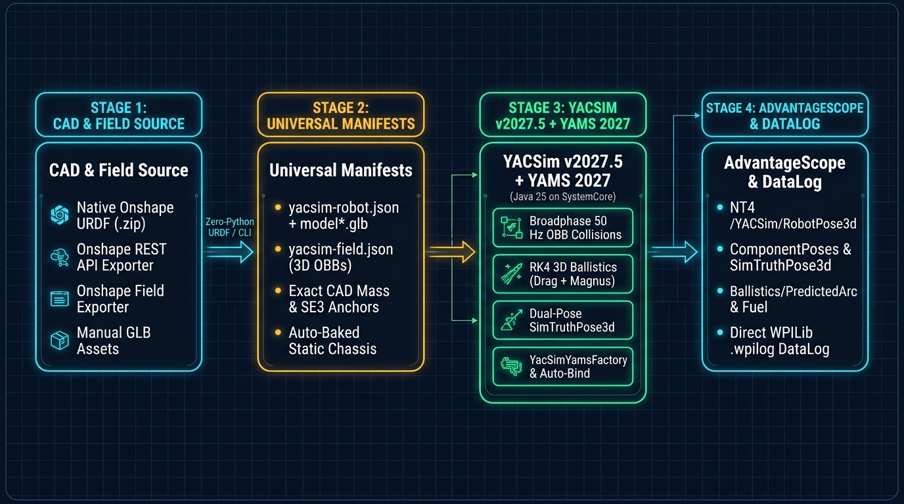
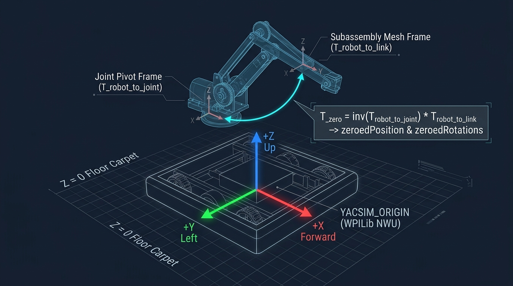
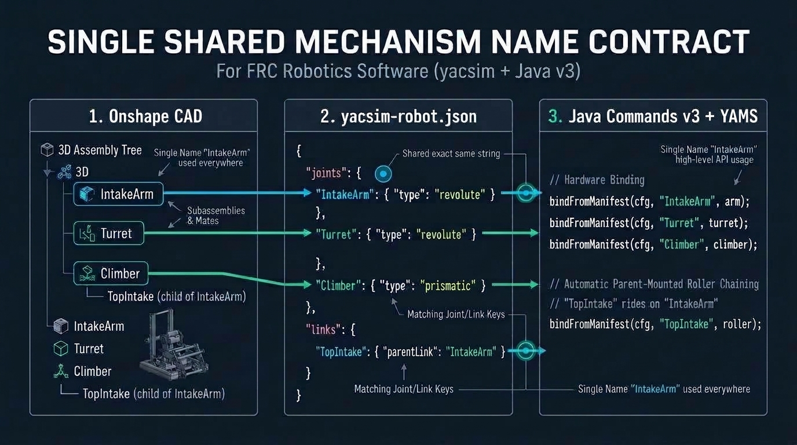

# End-to-End Implementation Walkthrough

This guide walks you step-by-step from a fresh WPILib 2027 Commands v3 robot project to a live, collision-checked 3D CAD simulation running in AdvantageScope—using either **Automated CAD Manifests (`yacsim-robot.json`)** or **Manual Java Configuration**.



---

## Choosing Your Setup Workflow

| Workflow | Best For | Python Required? | Where Geometry Lives |
| :--- | :--- | :--- | :--- |
| **1. Onshape Automated Manifest** *(Recommended)* | Teams designing in Onshape who want zero hand-typed pivots, limits, or masses | Yes (dev laptop only; stdlib-only, no `pip`) | `src/main/deploy/yacsim/<robot>/yacsim-robot.json` |
| **2. URDF XML Import** | Teams exporting `.urdf` from Onshape (`onshape-to-robot`), Fusion 360, or SolidWorks | No (pure Java 25 DOM parser) | `src/main/deploy/yacsim/<robot>/robot.urdf` |
| **3. AdvantageScope Directory Import** | Teams that already have a working `Robot_<Name>/config.json` + `model*.glb` bundle | No | `Robot_<Name>/config.json` |
| **4. Manual Java Configuration** | Quick prototypes or custom linkages configured directly in Java | No | Java (`CadRobotConfig` + `CadAssetConfig`) |

All four workflows can be mixed freely (for example, loading a manifest and overriding one custom pin-in-slot linkage in Java with `withComponentPoseSupplier("FrontHopper", ...)`).

---

## Step 1: Install the 2027 Vendordeps

1. Open your WPILib `2027_alpha7` Java 25 project in VS Code.
2. Install **WPILib Commands v3** (`CommandsV3.json`) and **YAMS for Commands v3** (`yams_commands3.json` from `https://cdn.yassrobotics.com/`).
3. Install **YACSim (`v2027.6.5-alpha1`)** via **WPILib: Manage Vendor Libraries -> Install new libraries (online)** using:
   ```text
   https://holyartist31656.github.io/YACS/vendordeps/yacsim_commands3.json
   ```
4. Install your motor controller vendordep:
   - **REV SPARK MAX / Flex**: `https://software-metadata.revrobotics.com/REVLib-2027.json`
   - **CTRE TalonFX / Kraken**: Phoenix 6 `26.70.0-alpha-2`+
5. Optional but recommended: add `application.applicationDefaultJvmArgs = ["-Xmx256m"]` in `build.gradle` to match SystemCore's memory envelope during desktop simulation.

---

## Step 2: Prepare Your CAD Assets

### Option A0 — Native Onshape URDF `.zip` (Zero Python, Zero API Keys)
Right-click your Onshape Assembly tab -> **Export...** -> **Format: `URDF`**, **Geometry format: `GLB`**, **Resolution: `Coarse`**, drop the downloaded `.zip` into `src/main/deploy/yacsim/`, and call `CadRobotConfig.fromUrdfOrZip(deployDir.resolve("yacsim/my_robot_urdf.zip"))`. See the [Native Onshape URDF Guide](ONSHAPE_URDF_GUIDE.md) for safe `*Or(...)` fallback getters and native `YamsCommands3Bridge.fromYamsMechanism(...)` binding.

### Option A — Export Automatically From Onshape (Python REST API CLI)
Follow the [CAD-to-Code Naming Conventions](CAD_CODE_NAMING_CONVENTIONS.md) and [Onshape Exporter Guide](ONSHAPE_EXPORTER_GUIDE.md):

```powershell
# Inspect all 1-DOF mates in ~2 seconds (no .glb download)
python tools/onshape-exporter/yacsim_onshape_exporter.py `
  --url "<YOUR_ONSHAPE_ASSEMBLY_URL>" `
  --list-mates

# Export yacsim-robot.json + binary GLB 2.0 meshes + striped spinning rollers
python tools/onshape-exporter/yacsim_onshape_exporter.py `
  --url "<YOUR_ONSHAPE_ASSEMBLY_URL>" `
  --robot-name MyRobot `
  --prefix yacsim_ `
  --out src/main/deploy/yacsim/myrobot
```



### Option B — Place Meshes Manually
Drop your `.glb`, `.gltf`, `.obj`, or `.stl` files into `src/main/deploy/yacsim/models/`. If exported from Onshape, Fusion 360, SolidWorks, or Inventor without a manifest, use `CadCoordinateSystem` presets (`CadCoordinateSystem.ONSHAPE_GLB`, `FUSION_360_OBJ_MM`, `SOLIDWORKS_STL_MM`, etc.) so orientation and units align on the first run.

---

## Step 3: Build Your YAMS 2027 Mechanisms

With a `CadRobotManifest`, your Java mechanism classes only define **electrical & control parameters** (CAN IDs, `DCMotor`, gearing, PID/FF gains). All CAD geometry (limits, length, MOI, carriage mass, wheel diameters) reads straight from `yacsim-robot.json`:

```java
// Example: Manifest-driven YAMS 2027 Arm (REVLib 2027 SPARK MAX)
public class IntakeArmMechanism implements Mechanism {
  private final Arm arm;

  public IntakeArmMechanism(CadRobotManifest manifest) {
    CadJointManifest joint = manifest.getJoint("IntakeArm");
    SparkMax motor = new SparkMax(CANPort.CAN_S0, 14, MotorType.kBrushless);

    SmartMotorControllerConfig motorConfig =
        new SmartMotorControllerConfig(this)
            .withControlMode(ControlMode.CLOSED_LOOP)
            .withClosedLoopController(2.5, 0.0, 0.0)
            .withSimClosedLoopController(50.0, 0.0, 0.0)
            .withGearing(new MechanismGearing(GearBox.fromReductionStages(25.0)))
            .withMomentOfInertia(manifest.getJointMomentOfInertia("IntakeArm"))
            .withZeroPower(MotorMode.BRAKE)
            .withStatorCurrentLimit(Amps.of(40))
            .withStartingPosition(joint.startingAngle())
            .withSoftLimits(joint.softMinLimitAngle(), joint.softMaxLimitAngle())
            .withTelemetry("IntakeArmMotor", TelemetryVerbosity.HIGH);

    SmartMotorController smc = new SparkWrapper(motor, DCMotor.getNEO(1), motorConfig);
    ArmConfig armConfig =
        new ArmConfig()
            .withHardLimits(joint.minLimitAngle(), joint.maxLimitAngle())
            .withLength(joint.length())
            .withTelemetry("IntakeArm", TelemetryVerbosity.HIGH);

    this.arm = new Arm(armConfig, smc);
  }

  public Arm getArm() { return arm; }
  public void periodic() { arm.updateTelemetry(); }
  public void simulationPeriodic() { arm.simIterate(); }
}
```

---

## Step 4: Wire YACSim Into Your Robot (`CadRobotMechanism`)



Bind every mechanism by its shared name using `YamsCommands3Bridge.bindFromManifest(...)`. Notice that parent-mounted rollers (such as `TopIntake` whose `parentLink` is `"IntakeArm"`) automatically chain onto the moving parent arm!

```java
Path manifestDir = Filesystem.getDeployDirectory().toPath().resolve("yacsim/myrobot");
CadRobotManifest manifest = CadManifestLoader.loadJson(manifestDir.resolve("yacsim-robot.json"));

CadRobotConfig robotConfig =
    CadRobotConfig.fromManifest(manifest, manifestDir)
        .withDrivetrainPoseSupplier(drive::getPose)
        .withExtensionMargin(0.35, 1.85)
        .ignoreRestingOverlaps()
        .withAutoInstallToAdvantageScope();

YamsCommands3Bridge.bindFromManifest(robotConfig, "IntakeArm", intakeArm.getArm());
YamsCommands3Bridge.bindFromManifest(robotConfig, "Turret", turret.getPivot());
YamsCommands3Bridge.bindFromManifest(robotConfig, "Climber", climber.getElevator());
YamsCommands3Bridge.bindFromManifest(robotConfig, "TopIntake", topIntake.getMotor());

CadRobotMechanism cadSim = new CadRobotMechanism(this, robotConfig);

// Optional: Bind Commands v3 safety triggers on OBB collisions or extension violations
CadCollisionTriggers.anyCollision(cadSim)
    .onTrue(Commands.runOnce(() -> System.out.println("Collision: " + cadSim.getCollisionDetails())));
```

In `Robot.java`, call `periodic()` inside `robotPeriodic()` (before `scheduler.run()`) and run `simulationPeriodic()` in a 20 ms `Notifier` inside `simulationInit()` (or let `cadSim.startManagedSimulation(0.02)` manage the Notifier for you).

---

## Step 5: Simulate & Inspect in AdvantageScope

1. Launch desktop simulation:
   ```powershell
   .\gradlew run "-Dorg.gradle.java.home=C:\Users\Public\wpilib\2027_alpha7\jdk"
   ```
2. Because `.withAutoInstallToAdvantageScope()` is enabled, YACSim installs `Robot_<Name>` directly into AdvantageScope's User Assets folder (`%APPDATA%/AdvantageScope/userAssets` on Windows) on startup.
3. Open **AdvantageScope** -> **Connect to Simulator (`127.0.0.1`)**:
   - In **3D Field**, drag `NT:/YACSim/RobotPose3d` as your Robot (select your `Robot_<Name>` model) and drag `NT:/YACSim/ComponentPoses` onto it as **Components**.
   - In **Line Graph**, drag `NT:/YACSim/Rollers/<name>/VelocityRPM`, `SurfaceSpeedMPS`, and `NT:/YACSim/CollisionActive`.
4. Enable **Teleop** in the WPILib Sim GUI Driver Station and watch your mechanisms, spinning rollers, and collision triggers come alive!

---

## Working Reference Projects

Explore all 4 runnable Commands v3 examples in [`examples/README.md`](../examples/README.md):
1. [`arm_and_elevator_2027`](../examples/commands3/arm_and_elevator_2027/) — Minimal starter (manual Java config).
2. [`darwin_6328_2027`](../examples/commands3/darwin_6328_2027/) — FRC 6328 *Darwin* (AdvantageScope directory import + CTRE Phoenix 6).
3. [`darwin_6328_manifest_2027`](../examples/commands3/darwin_6328_manifest_2027/README.md) — FRC 6328 *Darwin* (manifest-driven + 5 color-striped 3D spinning rollers).
4. [`gears_2181_2027`](../examples/commands3/gears_2181_2027/README.md) — FRC Team 2181 *GEARS* (REVLib 2027 `SparkMax`/`SparkFlex` + manifest + live Onshape workflow).
