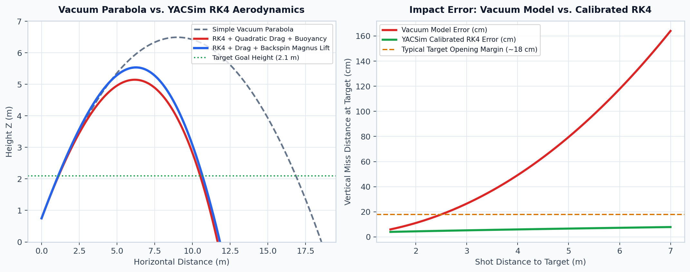

# How do I simulate 3D ballistics and tune drag?

**Goal:** Predict real-world landing spots and entry angles for foam/plastic FRC game pieces using YACSim's RK4 aerodynamic solver.

<figure><figcaption>
Beyond 3 meters, ignoring air drag and backspin lift causes errors larger than the target opening itself.
</figcaption></figure>



### Measure two shots on your practice field

Record the shooter exit speed, hood angle, horizontal landing distance, and entry angle at two distances (e.g., 2.5 m and 5.5 m).



### Fit your drag and Magnus coefficients

Use YACSim's 2-observable calibration fitter to solve for `dragCoeff` and `magnusCoeff` against your measured landing points and entry angles, then feed those calibrated constants directly into your lookup table or shoot-on-the-move solver.


