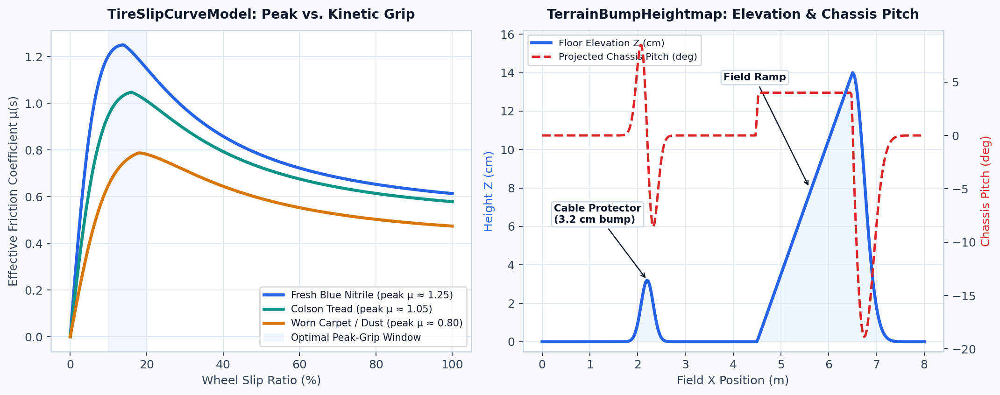

# How do I simulate field bumps and tire slip?

**Goal:** Stress-test your odometry, skid detector, and tilt scaler against realistic carpet grip drop-off and field bumps.

<figure><figcaption><p>Left: Tire friction peaks near 12–18% slip, then drops off sharply when wheels spin out. Right: Projecting a 2D pose onto cable protectors and ramps produces realistic pitch/roll transients.</p></figcaption></figure>

```java
// Clamp wheel force to what the tire can actually hold at its current normal load & slip ratio
double maxGripN = tireModel.maxTractionForceNewtons(loads.frontLeftNewtons(), slipRatio);
double actualForceN = tireModel.clampWheelForceNewtons(
    loads.frontLeftNewtons(), requestedWheelForceN, slipRatio
);
```


Pair `TerrainBumpHeightmap` with **YAECE** `ShotReadinessGate.recordChassisAccelerationG(...)` to verify that hitting a cable protector cleanly holds your shot until the chassis settles!

