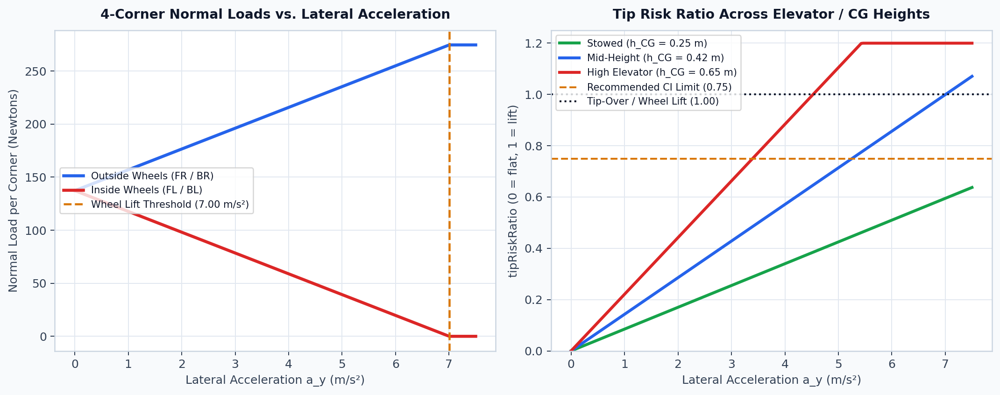

# Your First CAD-to-Sim Robot

By the end of this tutorial, you will load your robot manifest, model dynamic weight transfer over field bumps, run a JUnit 5 physics check on an autonomous trajectory, and inspect the 3D robot in AdvantageScope.

<figure><figcaption>
YACS tells you the exact acceleration where your inside wheels unload and your robot risks tipping.
</figcaption></figure>

## The four steps

| Step | What you will do |
| --- | --- |
| [Step 1: Export CAD or Load URDF](step-1-export-cad-or-urdf.md) | Load your robot's links, masses, and joints with `CadManifestLoader`. |
| [Step 2: Add Chassis Dynamics & Terrain](step-2-chassis-dynamics-and-terrain.md) | Configure `DynamicWeightTransferModel`, `TireSlipCurveModel`, and `TerrainBumpHeightmap`. |
| [Step 3: Validate Autonomous Paths in CI](step-3-validate-autonomous-paths.md) | Run `PathTrajectoryValidator` in JUnit 5 to catch tip or slip violations automatically. |
| [Step 4: View 3D Telemetry in AdvantageScope](step-4-advantagescope-3d.md) | Stream `Pose3d` chassis tilt, mechanism poses, and ballistics to AdvantageScope. |


**Before you start:** You should know basic Java and have a WPILib 2027 project with [AdvantageScope](https://docs.advantagescope.org/) installed. No prior CAD physics experience is required.

