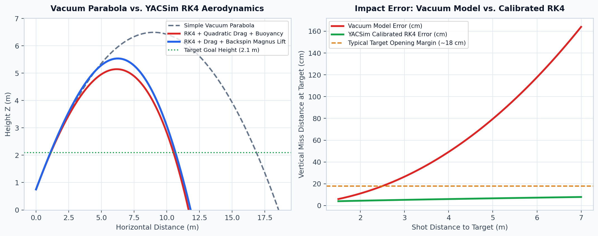

# RK4 Ballistics: Drag, Magnus Lift & Buoyancy

Lightweight FRC game pieces (foam balls, rings, hollow spheres) have a high surface-area-to-mass ratio, so textbook vacuum equations break down quickly. YACSim's 4th-order Runge-Kutta (RK4) integrator models four real forces at every sub-step:

1. **Quadratic air drag (`F_d ∝ v²`):** Steals horizontal velocity rapidly on long shots.
2. **Magnus spin lift (`F_m ∝ ω × v`):** Backspin keeps the projectile aloft longer and flattens the entry angle; topspin dives sharply.
3. **Air buoyancy (~3.3% of gravity for typical foam balls):** Reduces net downward weight.
4. **Added-mass effect (~1.7%):** Accounts for the air shell accelerated alongside a light sphere.

<figure><figcaption>
Calibrating drag and backspin lift keeps long-range error well inside the target opening.
</figcaption></figure>
