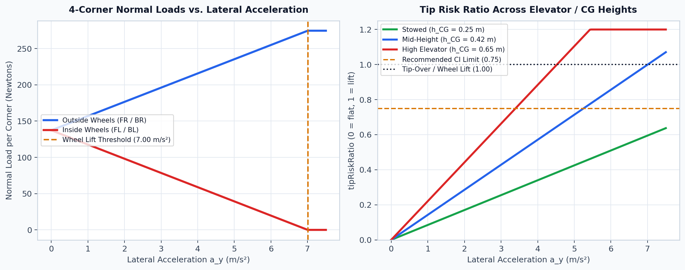

# Weight Transfer, 3-Wheel Lift & Tire Slip

When a 56 kg FRC robot accelerates laterally at `a_y`, inertial torque `m · a_y · h_CG` transfers normal load from the inside wheels to the outside wheels:

`ΔN_side = (m · a_y · h_CG) / trackwidth`

Once `ΔN_side` exceeds half the robot's weight (`m · g / 2`), the inside wheels lose contact with the carpet (`minCornerNewtons() == 0`) and `DynamicWeightTransferModel` recomputes exact 3-wheel equilibrium while flagging `isWheelLifting() == true`.

<figure><figcaption>
Raising an elevator from 0.25 m to 0.65 m cuts your safe cornering acceleration more than in half.
</figcaption></figure>

### Why peak-to-kinetic tire slip matters

Real swerve treads (Colson, Blue Nitrile) build peak grip around **12–18% slip ratio**. Past that peak, friction drops down to the lower kinetic value — which is why flooring the throttle on dusty carpet *reduces* acceleration and corrupts wheel odometry. `TireSlipCurveModel` captures this exact drop-off so you can test traction control and skid recovery before match day.
