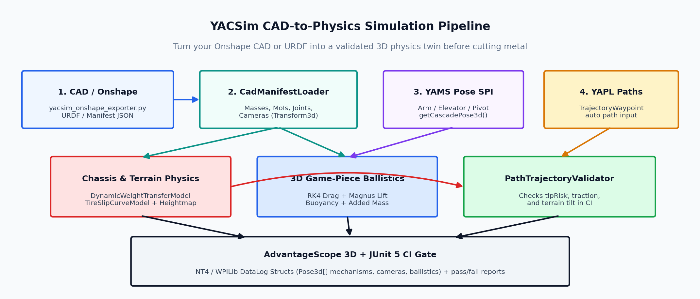

# Why YACS?

## The problem with "magic carpet" simulations

Default FRC simulations assume infinite tire grip, a flat table-top floor, zero chassis weight transfer, and vacuum ballistics. Your autonomous routine looks flawless on your laptop — then at your first regional, the robot lifts its inside wheels on a sharp turn, bounces over a cable protector, and shoots 30 cm short because of air drag.

## What YACS gives your team

1. **Direct CAD & URDF import:** `CadManifestLoader` reads link masses, moments of inertia, joint axes, and camera transforms straight from Onshape or URDF.
2. **Real chassis physics:** `DynamicWeightTransferModel` computes 4-corner normal loads and exact 3-wheel lift, `TireSlipCurveModel` models peak-to-kinetic grip drop-off, and `TerrainBumpHeightmap` projects your 2D pose onto cable protectors and ramps.
3. **Automated CI path validation:** `PathTrajectoryValidator` checks any autonomous path (from **YAPL**, Choreo, or PathPlanner) inside JUnit 5 and fails your build *before* a tipping auto reaches the field.
4. **Calibrated 3D ballistics:** RK4 integration with quadratic air drag, Magnus backspin lift, buoyancy (3.3%), and added mass (1.7%) matches real foam/plastic game pieces out past 6 meters.

<figure><figcaption>
YACS pairs cleanly with YAMS mechanism Pose3d SPIs and YAPL trajectories without locking you into any single vendor.
</figcaption></figure>
