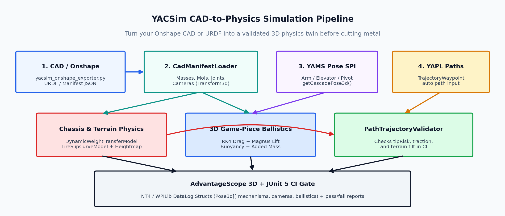

# Yet Another CAD Simulator (YACS)

<h2 align="center"><mark style="color:$primary;">Yet Another CAD Simulator (YACS)</mark></h2>

Export your robot once from Onshape or URDF. YACS gives you real mass/MoI physics, 3-wheel tip detection, Pacejka tire slip, field bump terrain, RK4 game-piece ballistics, and AdvantageScope 3D visualization, before your robot ever hits carpet.

<figure><figcaption>
From Onshape/URDF CAD to 3D AdvantageScope playback and automated JUnit 5 trajectory validation.
</figcaption></figure>

<table data-card-size="large" data-view="cards"><thead><tr><th></th><th></th><th></th><th data-hidden data-card-target data-type="content-ref"></th><th data-hidden data-card-cover data-type="image">Cover image</th></tr></thead><tbody><tr><td><i class="fa-cube">:cube:</i></td><td><strong>Start Your First CAD Sim</strong></td><td>Export your robot, add chassis dynamics and terrain bumps, and catch tipping autos in JUnit 5 CI in four guided steps.</td><td><a href="../documentation/tutorials/first-cad-sim/README.md">First CAD Sim Tutorial</a></td><td><a href=".gitbook/assets/yacs-weight-transfer-and-tip-risk.png">yacs-weight-transfer-and-tip-risk.png</a></td></tr><tr><td><i class="fa-wrench">:wrench:</i></td><td><strong>How-To Guides</strong></td><td>Step-by-step recipes for Onshape camera extraction, tire-slip &amp; bump modeling, YAPL path validation, and RK4 drag tuning.</td><td><a href="../documentation/how-to/simulate-bumps-and-tire-slip.md">How-To Guides</a></td><td><a href=".gitbook/assets/yacs-tire-slip-and-terrain.png">yacs-tire-slip-and-terrain.png</a></td></tr><tr><td><i class="fa-atom">:atom:</i></td><td><strong>Understand the Physics</strong></td><td>Visual explanations of 4-corner CG weight transfer, peak-to-kinetic tire grip drop-off, and aerodynamic ballistics.</td><td><a href="../documentation/understanding/weight-transfer-and-tire-slip.md">Understanding YACS Physics</a></td><td><a href=".gitbook/assets/yacs-rk4-ballistics-drag.png">yacs-rk4-ballistics-drag.png</a></td></tr><tr><td><i class="fa-code">:code:</i></td><td><strong>API &amp; Manifest Reference</strong></td><td>Full manifest JSON schema, YAMS Pose SPI bridges, and <code>ValidationLimits</code> defaults.</td><td><a href="../api-reference/README.md">API Reference</a></td><td><a href=".gitbook/assets/yacs-pipeline-architecture.png">yacs-pipeline-architecture.png</a></td></tr></tbody></table>
